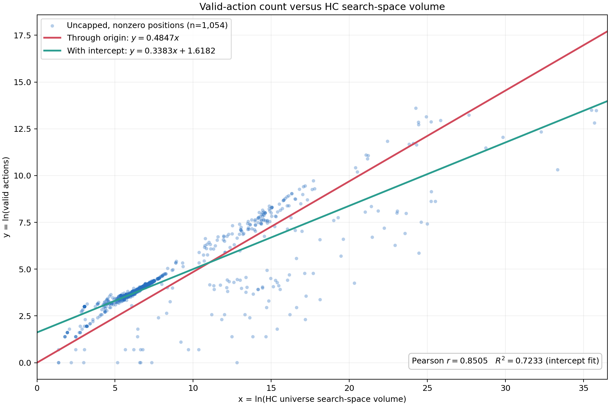

# Estimating the branching factor of 5D Chess

A useful heuristic for the number of legal actions $N$ is:

```math
\boxed{N\approx40^p}
```

Here $p$ is the number of **playable timelines**, rather than all timelines. This gives a compact estimate of the scale of the action space for Standard/Turn Zero games, useful for reasoning about search cost.

In the combined human/autoplay sample, composing the observed relations between playable timelines, HC universe volume $S$, and legal-action count gives:

```math
\begin{aligned}
\ln S &\approx9.0962p-3.5679,\\
\ln N &\approx0.40642\ln S+1.31578,\\
N &\approx0.874\cdot40.32^p.
\end{aligned}
```

A direct regression gives $N\approx0.858\cdot41.18^p$, supporting the simpler $40^p$ estimate. These combined fits used equal-game weighting. The composed estimate has log-RMSE about 1.08, so substantial position-to-position variation remains.

The estimate is also useful as a coarse scale estimate for human games: among 1,054 positive, exactly counted human positions, **88.9% had $40^p\le10N$**. Among the 479 positions where it overestimated $N$, **75.6% were overestimated by at most $10\times$**. It can also underestimate, so this is not an upper bound. The one-timeline positions dominate these percentages; the geometric-center overestimate at three playable timelines is about $11.4\times$.

The measurement process is biased against large action spaces. To bound enumeration time, counting stops at a finite action limit; 17 human positions still reached the million-action cap. Excluding them from positive exact-count regressions removes part of the upper tail. This is computational censoring, not evidence that human games never produce larger spaces. Behavior at four or more playable timelines is therefore much less certain.

## Definitions and collection

- $N$: number of legal actions, not individual piece moves or engine search iterations.
- $L$: total timelines (`timelines_total`).
- $p$: playable timelines (`timelines_playable`). These are different from total timelines.
- $A$: submitted player actions since the starting position.
- $S$: HC universe volume, stored as `ln_hc_universe_volume` to avoid constructing the enormous product directly.

The original corpus contained 62 human games. The collector loaded them with a Standard starting-position header, accepted 56, and rejected six with diagnostics. Sampling included the initial position, every fourth submitted action, the final position, and positions surrounding changes in total timeline count. Statistics and action counts came from `5dtools stats` and `5dtools count` with the `balanced` policy.

Counts were collected at limit 10,001, then only capped positions were recounted at higher limits:

| Stage | Positions counted | Newly resolved exactly | Still capped | Errors/timeouts |
|---|---:|---:|---:|---:|
| Initial limit 10,001 | 1,115 | 1,069 | 46 | 0 |
| Recount limit 100,001 | 46 | 13 | 33 | 0 |
| Recount limit 1,000,001 | 33 | 16 | 17 | 0 |

Each observation retains the limit used for its count. A count equal to that limit is a sentinel, not an exact measurement. The 17 remaining capped observations represent at least one million actions for practical reporting. There are 44 zero-action positions; they must be modeled separately from regressions of $\ln N$ and should not all be called checkmates without distinguishing stalemate.

## HC volume and legal actions

For 1,054 positive, uncapped human observations, let $x=\ln S$ and $y=\ln N$. The regression comparison was:

| Model | Formula | Centered R² | Log-RMSE |
|---|---|---:|---:|
| Through origin | $y=0.484670x$ | 0.5402 | 1.310 |
| With intercept | $y=0.338328x+1.618217$ | 0.7233 | 1.016 |

The intercept fit has Pearson correlation $r=0.85049$ and gives $N\approx5.0441S^{0.338328}$. Its reported fit statistics are in-sample, unlike the game-held-out validation of the original pilot.



The plot excludes zero counts and capped observations. The clusters and spread show why the relationship is a heuristic rather than a position-by-position identity.

## Color balance

The original sample contains 962 White-to-move and 153 Black-to-move positions (86.3% White). All 889 regular-grid positions are White to move, because action zero is White and the stride is four. The original pilot and HC regression therefore must not be presented as color-neutral.

A later collection paired positions after $4k$ actions with those after $4k+1$ actions, combining human and autoplay games. The balanced model retained complete pairs with nonzero, uncapped counts. Its human subset contains 835 positions per color (1,670 total) and gives:

```math
\ln N = 0.374147\ln S + 1.425223.
```

or $N\approx4.1588S^{0.374147}$, with R² 0.7818, log-RMSE 0.7531, and 87.1% within a factor of two. These are in-sample human-fit results.

For comparison, the paired autoplay fit was $N\approx3.1736S^{0.430811}$. Applied unchanged to the paired human subset, it achieved predictive R² 0.7567, log-RMSE 0.7951, and 92.5% within a factor of two. This supports useful transfer while keeping human and autoplay behavior distinct.

## Human-game calibration

The human sample helps assess how conservative $40^p$ is at each playable timeline count:

| Playable timelines $p$ | Positive exact positions | Geometric mean $N$ | $40^p$ | Approximate overestimate |
|---|---:|---:|---:|---:|
| 1 | 814 | 39.7 | 40 | 1.0× |
| 2 | 183 | 412 | 1,600 | 3.9× |
| 3 | 49 | 5,595 | 64,000 | 11.4× |
| 4 | 7 | 267,831 | 2,560,000 | 9.6× |

One additional positive exact observation lies outside these four groups. At $p=4$, five more observations were capped and three had zero legal actions, so the exact-count comparison is strongly censored.

Across all 1,054 positive exact observations, $40^p$ has log-space R² 0.405, log-RMSE 1.49, and 70.2% within a factor of two. The aggregate success rate is dominated by $p=1$, which accounts for about 77% of these observations.

The human-only regression gives $\ln N\approx2.484p+1.179$, or $N\approx3.25\cdot11.98^p$. Equalizing the weight of each human game gives $N\approx3.33\cdot11.65^p$. A compact human-only fit is therefore:

```math
N_{\mathrm{human}}\approx3.3\cdot12^p.
```

This is a compact description for human positions with $p=1,2,3$, with substantial scatter. It does not cover zero-action positions or establish growth above three playable timelines.

## Timeline count and game progress

### Dataset

- 1,115 sampled positions from 56 human games.
- 889 positions lie on the regular every-4-actions grid. This avoids enriching the fit with timeline-change samples, but all these grid positions are White to move; it is not color-neutral.
- Counts are capped at 1,000,001; 17 of all sampled positions hit the cap.
- The fitted domain is 1–6 timelines. Higher counts have too little data.

### Empirical distribution

The table uses the regular sampling grid. A value of 1,000,001 means 1,000,000+ legal actions.

| Timelines | Positions | Capped | P10 | Median | P90 |
| --- | --- | --- | --- | --- | --- |
| 1 | 717 | 0.0% | 20 | 46 | 68 |
| 2 | 83 | 0.0% | 38 | 89 | 5127 |
| 3 | 35 | 0.0% | 22 | 361 | 5391 |
| 4 | 24 | 4.2% | 0 | 842 | 312594 |
| 5 | 14 | 14.3% | 1153 | 2090 | 912706 |
| 6 | 13 | 15.4% | 6 | 778 | 800597 |
| 9 | 2 | 50.0% | 252926 | 584960 | 916993 |
| 10 | 1 | 0.0% | 437 | 437 | 437 |

### Timeline-count and game-age heuristic

Using total timelines $L$ and submitted actions $A$, define $a=\ln(1+A)$. The fitted center is:

```math
\mu(L,A) = -0.1437 + 3.3198L - 0.2136L^2 + 1.1883a - 0.2050a^2 - 0.2611La.
```

The model is $\ln(1+N)=\mu(L,A)+\varepsilon_L$. The residual quantiles below give rough conditional quantile estimates through $N_q=\exp(\mu+\varepsilon_{L,q})-1$; they do not establish a calibrated probability distribution.

| Timelines | Positions | Residual P10 | Median | P90 |
| --- | --- | --- | --- | --- |
| 1 | 717 | -0.313 | 0.084 | 0.468 |
| 2 | 83 | -1.503 | -0.278 | 3.140 |
| 3 | 35 | -3.883 | -0.139 | 2.025 |
| 4 | 24 | -6.130 | -0.340 | 5.294 |
| 5 | 14 | -0.932 | 0.073 | 6.384 |
| 6 | 13 | -4.681 | -0.150 | 5.692 |

This is a descriptive heuristic, not a calibrated probability model. On a game-held-out 20% split, the median multiplicative error was 1.37×, 66.1% of positions were within a factor of two, and log-RMSE was 1.622.

### Pilot limitations

- Positions with 1,000,001 actions are top-coded, so upper-tail quantiles are lower bounds.
- Timeline counts above six are too sparse for the formula.
- Total timelines and game age omit tactically important state. HC volume and playable/mandatory timeline counts should be evaluated as additional predictors.

## Rough envelopes

On the original positive exact human sample, $4\sqrt S$ exceeded the measured count in 94.5% of positions; 58 positions exceeded that estimate, with a worst underestimate of 1.15×. It can serve as a rough high estimate, not a guaranteed capacity bound.

The original claim that $5\sqrt S$ covered every exact observation in both human and autoplay data was superseded by the later balanced collection: one autoplay outlier exceeded it. On the paired data, $4\sqrt S$ covered 93.2% of exact human observations and 97.1% of exact observations overall. Even an envelope covering all measured positions says nothing conclusive about the capped tail or unseen games.
