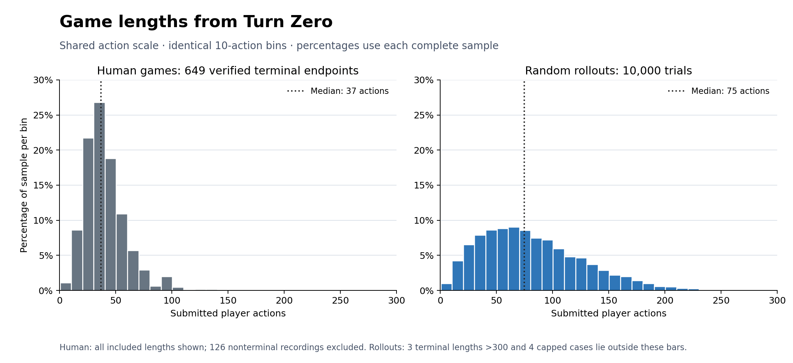
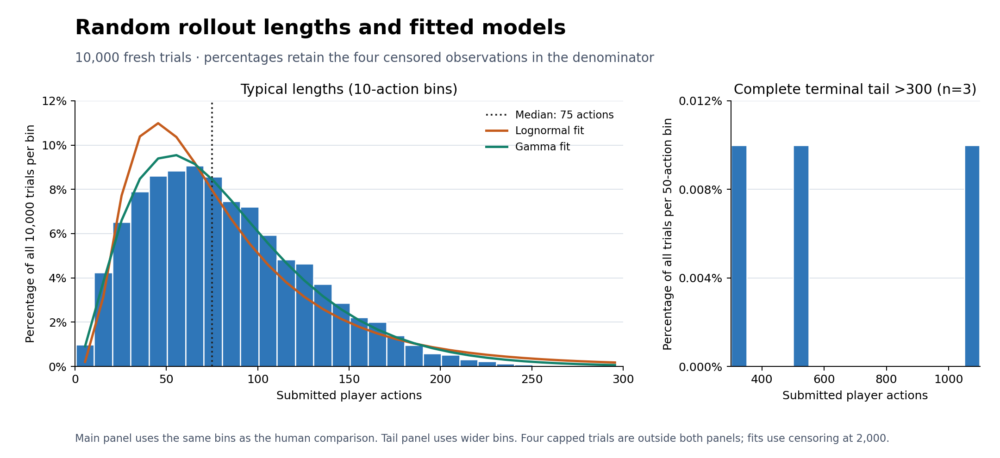
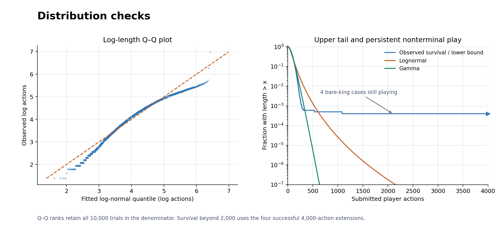
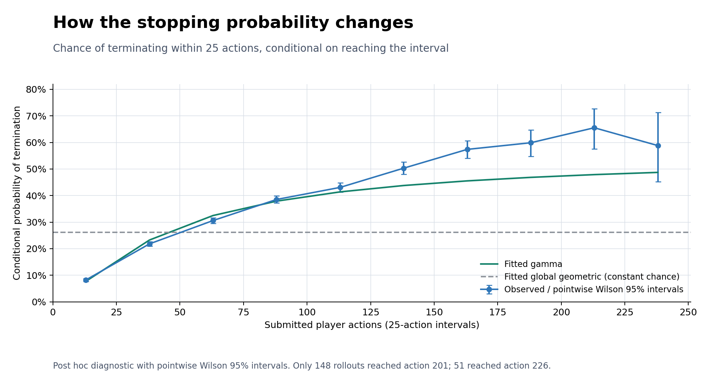
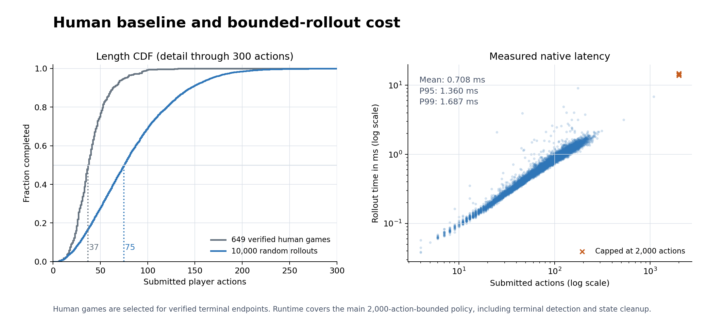

# Game length and rollout cost in Standard - Turn Zero

Verified human games and fresh random rollouts from the same opening have
median lengths of **37 and 75 submitted player actions**, respectively. This
article combines endpoint verification of the expanded human database with
**10,000 independent seeded rollouts**, using a common length unit.

The rollout measurements reject a single log-normal or gamma distribution as
a complete length model. **Gamma is the closest tested approximation**, and its
changing stopping rate is a useful descriptive model for typical trajectories.
An eventual constant stopping probability remains a hypothesis for the late
tail, rather than an established property of these rollouts.

**Bounded rollout evaluation is computationally practical from this opening on
the measured machine:** with a 2,000-action cap, mean native latency was
**0.708 ms**, and a separate one-minute run completed **86,699 rollouts**. Four
main trials remained nonterminal at 4,000 actions; a longer replay crashed at
the engine's time-coordinate boundary. Unrestricted termination and the
quality of rollout scores as positional evaluations remain unverified.

## Length unit and experimental questions

All histogram horizontal axes use **submitted player actions**. One action
completes one player's turn and can contain multiple piece moves on different
timelines. Actions exclude starting-position boards, comments describing
unfinished actions, and alternative history branches. Board-time coordinates
such as `T20` are not length counters: time travel can move the present backward.

Numbered turns are a secondary measure, `ceil(actions / 2)`: a final White-only
turn counts as one numbered turn. For example, 59 submitted actions occupy
30 numbered turns. The human and rollout medians correspond to 19 and 38
numbered turns. Statistics use nearest-rank empirical quantiles.

The experiments ask how long verified human games and random rollouts last,
whether a simple distribution describes rollout length, and whether enough
bounded rollouts can be computed for evaluation. Measurements concern
`[Variant "Standard - Turn Zero"]`, the engine's `startpos`; intermediate human
positions require a separate experiment.



The comparison histograms use identical **10-action bins**, horizontal scales,
and percentage scales. Human percentages use the 649 included terminal games;
rollout percentages use all 10,000 main trials. The rollout bars omit four
censored observations without renormalizing the remaining trials. Three
terminal rollout lengths above 300 are shown later in a separate tail panel.
The saved shared bins cover every measured terminal length through 1,100 actions.

## Human database and endpoint verification

Measurements were collected on 2026-10-08 from
[`test/pgn/online/`](../../test/pgn/online/). The collection contains 795 games:
775 Standard - Turn Zero, 15 Standard - Defended Pawn, three Standard - Two
Timelines, and two Custom. Only Standard - Turn Zero was selected.

Each selected PGN was freshly loaded through `engine.game.from_pgn()` and its
endpoint examined with `game.get_match_status()`. This searches for a legal
action; when none exists, checks distinguish checkmate from stalemate. Verification
did not use the `Result` header, the import audit's classification, or result
annotations. Consequently, a terminal game is included even when verification
corrected its original source result. Softmate remains nonterminal.

| Classification | Games | Histogram |
| --- | ---: | --- |
| Verified White checkmate win | 348 | Included |
| Verified Black checkmate win | 300 | Included |
| Verified stalemate | 1 | Included |
| Nonterminal Turn Zero endpoint | 126 | Excluded |
| Other starting variants | 20 | Excluded |
| Total database | 795 | 649 included |

All 775 selected games loaded and were classified without errors or timeouts.
A 30-second per-game verification limit was available but never reached. All
selected games had the same initial-state hash and contained no alternative
history branches. Their endpoint hashes were distinct.

There are 608 included games from the t0database source and 41 from the legacy
`games.toml` collection, as identified by their exported `Site` headers. The
[database README](../../test/pgn/online/README.md) documents sources, deduplication,
corrections, and incomplete final actions. The stalemate is
[`757.5dpgn`](../../test/pgn/online/757.5dpgn); the longest included game is
[`004.5dpgn`](../../test/pgn/online/004.5dpgn).

Human lengths were counted by walking from each loaded endpoint to the root
with `has_parent()` and `visit_parent()`. The median is **37 actions**, the mean
is **40.44**, and the complete range is **6–132**. Ninety percent end within
64 actions. These measurements describe the distribution conditional on a
verified terminal endpoint. The 126 excluded recordings can represent
resignations, timeouts, or incomplete records; their recorded lengths are not
verified times to checkmate or stalemate. Exclusion can change the distribution,
so this curated sample is not a random sample of all human games.

## Fresh random rollouts

### Policy and collection

The experiment was conducted on 2026-10-08. Every trial started from
`[Variant "Standard - Turn Zero"]`, the engine's `startpos`, with initial-state
hash `108895e6542b2533`. Every selected human game has the same initial-state hash.

Action selection called the production `random_action_selection` in
[`rollout_policy.cpp`](../../src/engine/rollout_policy.cpp): build the HC search
space, shuffle coordinate order independently within each axis, and return the
first legal action found by the existing mixed search. Search-space ordering
retains its preference for fewer new timelines. This is a biased random policy;
it does not sample uniformly from all legal actions. Both colors use the same
selector.

The native driver used the existing
[`default_policy_t`](../../src/engine/default_policy.h), including its state
transitions and terminal evaluation. A separate `std::mt19937` was initialized
for each trial. The driver exposed the action count and termination reason that
the production policy already returns, rather than relying on the CLI's less
detailed CSV.

At an action limit, a custom cutoff evaluator called `evaluate_zero_position()`
on the final state without playing another action. This distinguishes an actual
terminal state exactly at the limit from a nonterminal cutoff. It does not
change the preceding action sequence. Main timing includes this boundary check
when applicable.

| Phase | Trials | Seeds | Action limit | Per-trial timeout |
| --- | ---: | --- | ---: | ---: |
| Pilot | 200 | 2,500,000–2,500,199 | 2,000 | 30 s |
| Main | 10,000 | 5,000,000–5,009,999 | 2,000 | 30 s |

The pilot finished without caps or timeouts, averaging 78.29 actions and
0.698 ms per rollout, with a maximum length of 238. The main limits, sample size,
training/test split, statistical families, and bootstrap settings were fixed
before starting the main collection. Pilot results are excluded from all main
fits and statistics. The older rollout histogram and its underlying results
were not reused.

Main simulations ran sequentially with no competing rollout worker. The machine
was an **Apple M1 Pro, eight CPU cores (six performance and two efficiency),
16 GB RAM**, running macOS 15.8.1. The native build used Apple Clang 17.0.0,
Release optimization (`-O3 -DNDEBUG`), and thin LTO. The source revision was
`95751dc70be957e7dbc1b76e497ef6f9deea81f9`; source-file hashes are saved in the
summary. Collection and analysis used `/opt/anaconda3/bin/python`, NumPy 1.26.4,
SciPy 1.13.1, and Matplotlib 3.9.2.

### Outcomes and observed lengths

| Main outcome | Trials | Fraction |
| --- | ---: | ---: |
| White wins | 4,944 | 49.44% |
| Black wins | 5,049 | 50.49% |
| Stalemate | 3 | 0.03% |
| Nonterminal at 2,000 actions | 4 | 0.04% |
| Errors or timeouts during main collection | 0 | 0% |

The censored trials remain in the sample. They are not counted as stalemates or
as terminal games of length 2,000.

| All-trial length statistic | Actions | Bootstrap 95% interval |
| --- | ---: | --- |
| Median | 75 | 74–76 |
| P90 | 145 | — |
| P95 | 167 | 165–169 |
| P99 | 210 | 205–215 |

These quantiles lie below the cap and remain observable despite the four
censored trials. Empirical quantiles use the nearest-rank convention. The
minimum terminal length was four actions, and the maximum was 1,085. Among the
9,996 terminal trials, mean length was **81.98 actions**; this is a conditional
mean, not the mean of unrestricted rollout length. The mean of
`min(length, 2000)` was **82.7444 actions** (bootstrap 95% interval 81.54–83.98).

Three terminal rollouts exceeded 300 actions, including two longer than 500.
The fitted-model histogram below separates the typical range from the complete
observed terminal tail. Its bars omit the four censored trials, whose behavior is
reported separately.

The same trajectories imply these completion rates at smaller action caps,
provided that terminal positions exactly at a cap are checked:

| Action cap | Terminal by that cap | Completion rate |
| --- | ---: | ---: |
| 120 | 8,013 | 80.13% |
| 200 | 9,852 | 98.52% |
| 500 | 9,994 | 99.94% |
| 2,000 | 9,996 | 99.96% |

Thus a 200-action experiment would leave 148 outcomes unresolved. Treating
those as exact lengths would distort the upper tail.

## Length comparison and distribution models

| Statistic | Verified human games | Random rollouts |
| --- | ---: | ---: |
| Sample size | 649 terminal games | 10,000 trials; 9,996 terminal |
| Minimum terminal length | 6 actions | 4 actions |
| Median | 37 actions | 75 actions |
| P90 | 64 actions | 145 actions |
| P95 | 76 actions | 167 actions |
| P99 | 99 actions | 210 actions |
| Mean among terminal outcomes | 40.44 actions | 81.98 actions |
| Maximum terminal length | 132 actions | 1,085 actions |

Typical random rollouts are about twice as long as the selected human games on
the median and conditional-mean measures. This is a descriptive comparison:
the human sample excludes nonterminal recordings, while the rollout sample
retains right-censored trials. It does not establish a common distribution
family or a causal effect of the two policies.

### Fitted length distributions



Percentages retain all 10,000 trials in the denominator. The main panel uses
the same 10-action bins as the human comparison; the sparse terminal tail uses
explicitly labeled 50-action bins. Four unresolved trajectories have no
measured terminal lengths and appear in the survival analysis instead.



The tested log-normal hypothesis is the ordinary two-parameter, zero-location
family, discretized to respect integer lengths. For continuous positive
variable $X$, set $K=\lceil X\rceil$:

```math
\Pr(K=k)=F(k)-F(k-1),\qquad k=1,2,\ldots.
```

Terminal observations contribute this probability to the likelihood; an
unresolved trial at cap $C=2000$ contributes $\Pr(K>C)=1-F(C)$. Gamma and Weibull
use the same discretization and zero location. Geometric is the corresponding
constant-hazard alternative, equivalent to discretizing a zero-location
exponential.

Models were fitted by maximum likelihood, including all four censored
observations, using Nelder–Mead optimization in log parameters. Final likelihoods
agreed when fitted from additional starting points. A discrete Kolmogorov–Smirnov
statistic compared the empirical and
fitted CDFs of the observed, capped sample. For each model, **999 parametric
bootstrap samples** of size 10,000 were generated, censored at the same cap,
refitted, and retested. Refitting is necessary when calibrating tests with
estimated distribution parameters; see the
[SciPy goodness-of-fit procedure](https://docs.scipy.org/doc/scipy/reference/generated/scipy.stats.goodness_of_fit.html).
The custom calculation additionally preserves integer lengths and censoring.

| Model | KS distance | Bootstrap p | AIC | Held-out mean negative log-likelihood |
| --- | ---: | ---: | ---: | ---: |
| Log-normal | 0.06011 | 0.001 | 104,491.98 | 5.21597 |
| Gamma | **0.01996** | 0.001 | **103,847.73** | **5.19012** |
| Weibull | 0.04274 | 0.001 | 104,777.25 | 5.24279 |
| Geometric | 0.19110 | 0.001 | 108,160.55 | 5.40195 |

No bootstrap statistic exceeded its corresponding observed statistic. The
reported p-value is `(exceedances + 1) / (999 + 1)`, so **0.001 is the Monte Carlo
resolution**, not an exact tail probability. All four models are rejected at
the preselected 5% level. Smaller AIC and held-out negative log-likelihood are
better. Held-out scores used parameters fitted on trials 1–8,000 and evaluated
on trials 8,001–10,000, including their respective censored observations.

The fitted log-normal parameters are $\mu=4.21523$ and $\sigma=0.66540$ for
$\ln X$. Its maximum CDF discrepancy is about six percentage points, and its
quantile predictions overestimate much of the finite upper tail:

| Quantile | Observed actions | Log-normal prediction | Gamma prediction |
| --- | ---: | ---: | ---: |
| Median | 75 | 68 | 73 |
| P90 | 145 | 159 | 150 |
| P95 | 167 | 203 | 178 |
| P99 | 210 | 319 | 240 |

Gamma, with shape 2.72279 and scale 30.21050, is a better descriptive
approximation among these candidates. It is not a validated distribution law.
None of the four families accurately describes both the observed body and
censored tail. For example, the log-normal model predicts probability
$1.81\times10^{-7}$ of exceeding 2,000 actions, versus the observed
$4\times10^{-4}$, while gamma predicts an even smaller probability. A future
model should address potential nontermination separately instead of assuming
that every trajectory has a finite terminal length.

### What rejection means for gamma and log-normal

A visually useful approximation can fail a goodness-of-fit test with 10,000
trials. The largest CDF discrepancy is 6.01 percentage points for log-normal
and 2.00 for gamma. The 95th percentiles of those discrepancies in their refitted
bootstrap samples are only 0.85 and 0.88 percentage points, respectively.
At 73 actions, 48.49% of rollouts had finished, versus the log-normal prediction
of 54.50%; at 75, 50.19% had finished, versus gamma's 52.19%. The largest
disagreements therefore occur in the body of the distribution. The four
censored cases, totaling 0.04% of the sample, are a separate tail issue.

Gamma remains a reasonable approximation for typical lengths, especially
compared with log-normal, while the test rejects the stronger claim that one
gamma distribution explains the full sample up to sampling error.

An often-cited ordinary-chess log-normal claim describes an approximation to
731,000 human FICS games, with ratings above 2000 and non-blitz controls, rather
than a universal formally tested law. Human play and random 5D rollouts need not
share that approximation; see the
[original analysis](https://chess.stackexchange.com/questions/2506/what-is-the-average-length-of-a-game-of-chess).

### Stopping probability and an eventual constant-rate tail

The relevant stopping probability is conditional on still playing. If
`P(L = t + 1 | L > t) = p` is constant after an initial action count $t_0$, then

```math
\Pr(L>t_0+k\mid L>t_0)=(1-p)^k.
```

The remaining integer length follows a geometric distribution; the continuous
counterpart is exponential. An initial buildup followed by this behavior would
give a different full distribution. The global geometric model tested above
does not test the more limited claim that a constant stopping chance emerges
after an unknown initial phase. See the
[geometric distribution](https://docs.scipy.org/doc/scipy/reference/generated/scipy.stats.geom.html).

A gamma distribution with shape greater than one has a stopping rate that rises
toward a constant. For integer shape it can represent the combined waiting time
through several independent exponential stages with a common rate. An eventual
constant rate is therefore compatible with a gamma tail, but does not determine
the entire distribution; see the
[gamma distribution](https://docs.scipy.org/doc/scipy/reference/generated/scipy.stats.gamma.html).
No such stage mechanism has been established for this rollout policy.



A post hoc diagnostic from the saved main trials counts terminal outcomes in
each interval among trajectories that reached its first action:

| Action interval | Trials entering | Terminal in interval | Conditional stopping probability |
| --- | ---: | ---: | ---: |
| 1–25 | 10,000 | 823 | 8.23% |
| 26–50 | 9,177 | 2,001 | 21.80% |
| 51–75 | 7,176 | 2,195 | 30.59% |
| 76–100 | 4,981 | 1,919 | 38.53% |
| 101–125 | 3,062 | 1,319 | 43.08% |
| 126–150 | 1,743 | 877 | 50.32% |
| 151–175 | 866 | 497 | 57.39% |
| 176–200 | 369 | 221 | 59.89% |
| 201–225 | 148 | 97 | 65.54% |
| 226–250 | 51 | 30 | 58.82% |

A constant per-action stopping chance would give the same probability in every
equal-width interval. The observed chance rises through much of the rollout,
suggesting a gradual buildup. Beyond 200 actions, the risk set is small and
uncertainty grows. The plot shows pointwise Wilson 95% intervals, not simultaneous
bands or a formal test for a selected late-tail threshold. Different positional
regimes and persistent bare-king play are plausible reasons that one simple
distribution fails, but their contributions have not been isolated.

## Persistent nonterminal trials and the representation limit

The four censored main trials were replayed from their original seeds. All
remained nonterminal at 4,000 actions, on a single timeline containing only the
two kings:

| Trial | Seed | Board at 4,000 actions |
| --- | ---: | --- |
| 724 | 5,000,723 | `8/8/1k6/8/8/8/2K5/8` |
| 5,820 | 5,005,819 | `8/8/8/8/4K3/8/8/k7` |
| 6,836 | 5,006,835 | `8/8/8/6K1/8/8/8/4k3` |
| 9,535 | 5,009,534 | `4k3/8/8/8/8/K7/8/8` |

The implemented termination condition checks for checkmate or stalemate; it
does not terminate these positions as insufficient-material draws. Legal
physical king moves remained available, and the policy prefers them to creating
timelines. The same-seed extensions demonstrate persistent nonterminal play,
not a measured finite termination time. Nontermination is plausible under this
policy, but a finite replay does not itself prove an infinite continuation for
each seed.

Initially, extensions to 20,000 and then 200,000 actions were planned. The first
20,000-action attempt, seed 5,000,723, crashed. An 8,000-action replay reproduced
the crash; AddressSanitizer reported a null read in `check_position::scan`, with
a wrapped time coordinate of `-2048`. The packed time coordinate in
[`vec4.h`](../../src/misc/vec4.h) has maximum `T_MAX = 2047`. The successful
4,000-action replays reached present time 2,001, still within that range.

The extension protocol was therefore revised to 4,000 actions. Failed attempts
are saved as errors with unknown lengths, not as terminal observations or
successful 20,000-action rollouts. The main data and its original 2,000-action
censoring are retained for statistical analysis. The coordinate-boundary issue
was diagnosed but not changed as part of this experiment.

## Computational cost and evaluation precision



Main timing covers `evaluate()` from copying the initial state through terminal
detection and state cleanup. It excludes process startup, opening parsing, RNG
construction, and output formatting. The complete collection took **7.146 s**
wall time, compared with **7.077 s** summed timed evaluations.

| Native latency, cap 2,000 | Measured | Bootstrap 95% interval |
| --- | ---: | --- |
| Mean | 0.7077 ms | 0.6983–0.7176 ms |
| Median | 0.6591 ms | 0.6505–0.6676 ms |
| P95 | 1.3602 ms | 1.3434–1.3740 ms |
| P99 | 1.6866 ms | 1.6475–1.7235 ms |
| Maximum | 14.7872 ms | — |

This is the cost of a **bounded** rollout, including the capped trials. It is
not an estimate of unrestricted time to a terminal outcome. At the collection's
wall-time throughput, 100 rollouts cost about 0.071 s and 1,000 about 0.715 s.
These two figures are throughput-derived estimates.

Separate native budget runs used new seed ranges and the same 2,000-action cap.
They included RNG construction and loop overhead, with no per-trial CSV output.
The opening was loaded before the clock started. Only trials completed by the
deadline were counted; finishing the last trial overran the deadline by less
than one millisecond.

| Time budget | Completed rollouts | Capped outcomes | Nominal 95% sampling half-width |
| --- | ---: | ---: | ---: |
| 1 s | 1,472 | 0 | ±2.55 percentage points |
| 10 s | 14,342 | 2 | ±0.82 percentage points |
| 60 s | 86,699 | 26 | ±0.33 percentage points |

The half-width uses the normal approximation with worst-case variance $1/4$
for a payoff bounded in $[0,1]$. It describes Monte Carlo precision for the
specified policy, not uncertainty about optimal chess play. Native child-process
peak resident memory across these runs was **7.56 MiB**, excluding the Python
collection and analysis processes.

For a White-perspective payoff of one for a win, zero for a loss, and one-half
for stalemate, assigning unresolved outcomes the midpoint gives main-sample
estimate **0.49475**. Holding the observed terminal outcomes fixed, assigning the
four unresolved cases any payoffs in $[0,1]$ gives range **0.49455–0.49495**. This
range concerns cutoff uncertainty alone, not sampling uncertainty. White's
observed win fraction has Wilson 95% interval **48.46%–50.42%**; this main sample
does not establish a color advantage.

A cutoff is therefore affordable and rare at 2,000 actions for this opening,
but is needed for persistent nonterminal trajectories. Fast sampling does not
by itself establish that the resulting score is a strong positional evaluator.

## Limitations and intermediate human positions

Human endpoint selection can change the measured length distribution; the
curated human sample and all-trial rollout sample have different inclusion
rules. The comparison does not infer the duration of excluded recordings.
Rollout model tests concern the specified zero-location families, discretization,
and HC policy. They do not exclude shifted distributions, stage models, or
mixtures as future approximations. The stopping-probability diagnostic is
descriptive and does not establish an eventual constant-rate tail.

The next experiment should sample intermediate **Standard - Turn Zero human
positions**, covering game progress, both sides to move, and playable timeline
counts, with positions from different games represented. Position selection
should be fixed before collecting rollout results. Restricting snapshots to
verified-endpoint games would inherit the human baseline's selection condition
and must be stated if chosen. Opening latency and its low cutoff rate cannot
establish cost or termination behavior for those positions.

## Data, reproduction, and validation

The original per-game and per-rollout observations are retained. Histograms use
the recorded action counts directly; numbered turns are secondary metadata.

### Human measurements and common histogram bins

- [Per-game measurements and inclusion decisions](res/human-game-length.csv): all
  775 Turn Zero games, including the 126 exclusions, with source filenames,
  action and numbered-turn counts, freshly verified statuses, and PGN hashes.
- [Human histogram bin counts in actions](res/human-game-length-bins.csv) and
  [shared human/rollout bins](res/game-length-turn-zero-bins.csv): inclusive integer
  ranges, counts, and fractions. Human counts sum to 649 and terminal rollout
  counts to 9,996; the four censored observations have no terminal bin.
- [Human collection summary](res/human-game-length-summary.json): source revision,
  database digest, verification settings, numerical summaries, and current
  histogram metadata. A [standalone human histogram](res/human-game-length.png)
  uses the same action bins and scales as the comparison.

The human Python module was rebuilt from revision
`95751dc70be957e7dbc1b76e497ef6f9deea81f9` and loaded by
`/opt/anaconda3/bin/python` from `build/`. That build was Debug; it supplies
endpoint verification, not the native Release rollout timing.

To reproduce human selection, load files whose `Variant` header is exactly
`Standard - Turn Zero`, call `get_match_status()`, and count parent transitions.
Include `WHITE_WINS`, `BLACK_WINS`, and `STALEMATE`; exclude `PLAYING`.
Numbered turns remain `(submitted_actions + 1) // 2`. To redraw histograms from
the saved data, filter human rows with `included=true` and use their
`submitted_actions`; use terminal main rollout rows and their `actions`.
Integer action bins are 1–10, 11–20, and so on, with half-integer edges 0.5,
10.5, 20.5, etc. Divide human counts by 649 and rollout counts by 10,000 before
converting to percentages. The comparison shows 1–300; shared saved bins extend
through 1,100 to retain the complete terminal tail.

Human validation compared counted turns with canonical PGN numbering for all
775 selected games and independently compared terminal classifications with
`5dtools checkmate`; both agreed in every case. The existing `run_games` native
test passed, loading all 795 database fixtures twice.

### Rollout measurements and statistical reproduction

The saved artifacts are:

- [Main trials](res/rollout-turn-zero.csv), [separate pilot](res/rollout-turn-zero-pilot.csv),
  and [extension attempts](res/rollout-turn-zero-extensions.csv).
- [Model fits](res/rollout-turn-zero-models.csv) and
  [all refitted bootstrap statistics](res/rollout-turn-zero-model-bootstrap.csv).
- [Conditional stopping counts and intervals](res/rollout-turn-zero-stopping-probability.csv).
- [Measured budget runs](res/rollout-turn-zero-budgets.csv) and
  [full collection and analysis summary](res/rollout-turn-zero-summary.json).

One-off C++ measurement drivers and Python scripts were kept outside the
repository. No production code or rollout policy was changed. Reproduction
uses the recorded starting variant, seed ranges, source/toolchain, and existing
`default_policy_t` with `random_action_selection`; each trial constructs a fresh
seeded policy, evaluates the same initial state, and records its returned
`num_actions` and termination. Exact seed replay assumes the same
standard-library shuffle implementation. The cutoff-boundary legality probe is
described above.

For statistical reproduction, use probability masses `F(k)-F(k-1)`, survival
likelihood for `ACTION_LIMIT` rows, and the original cap of 2,000. The extension
rows are diagnostics, not extra independent trials. The model bootstrap used
NumPy RNG seed `2026100801`; the 1,999-resample confidence bootstrap used
`2026100802`. The separate budget runs started at seeds 10,000,000, 20,000,000,
and 30,000,000. The summary records artifact and source hashes.
The stopping diagnostic uses `terminal_in_interval / trials_entering_interval`
in fixed 25-action intervals; counts come from the saved main trials, with
pointwise Wilson 95% intervals.

Eight main seeds were replayed with identical action counts and outcomes; their
winners also agreed with the production `5dtools rollout` command. Boundary
checks for seed 5,000,099 produced a cutoff at 108 actions and its actual White
win at both limits 109 and 110, with terminal length 109. The existing
`test_mcts_policies` native test passed. Artifact totals, fitted-model statistics,
documentation links, and figure layouts were checked. The combined plots and
bin files were rechecked against unchanged per-game and per-rollout CSVs.
