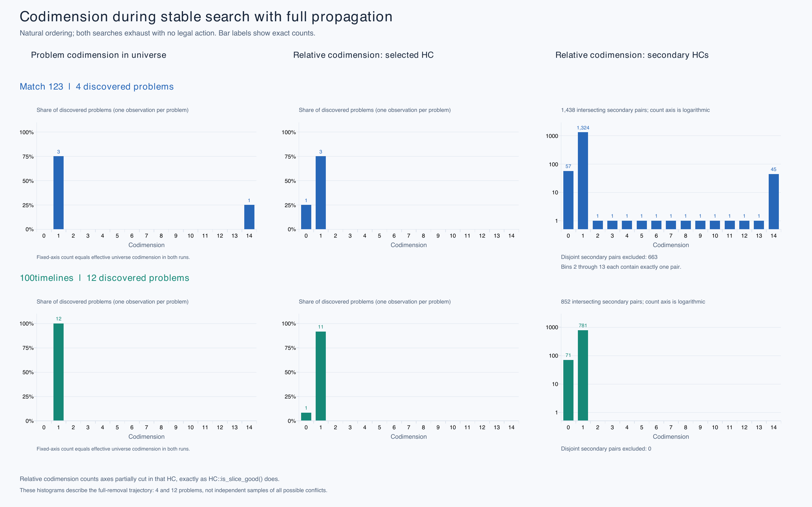

# Hypercuboid search: findings and open questions

The experiments use matches 59, 72, and 123 and `100timelines` in
`test/pgn/slow/`, main lines from 50 online games, and complete enumeration of
the 30,134-action, 55,332-action, and final NP positions. The slow positions
may be strongly biased. The propagation comparison predates the 100-problem
fallback changes; the deferred-policy and point-removal comparisons below are
separate, later measurements.

## Findings

1. **Preserve global conflicts.** HC-local problem construction clips reusable
   constraints and causes repeated rediscovery. `take_point()` enforces matching,
   not Present advancement or royal safety; no matching correctness defect was
   identified here.

2. **Match 123 has a short contradiction.** Full-removal stable search discovers
   one Present constraint and three royal-safety constraints. After propagation,
   663 further HCs produce no matching point. Exhaustion takes about 34 ms and
   the position is checkmate.

3. **One slice causes the fragmentation burst.** The Present problem has
   universe codimension 14 but relative codimension 1 in its originating HC.
   Propagation expands **58 HCs to 721**. All 12 problems in `100timelines`
   have universe codimension 1, with no intersecting target exceeding 1.

4. **The three unary safety constraints attack historical kings.** The attacks
   are knight `(23T15)g6 → (21T15)g5`, bishop `(-11T16)g7 → (-7T16)g3`, and
   bishop `(3T18)f8 → (3T11)f1`. Targets and intermediate boards are fixed
   history, so other action coordinates cannot repair them. Eager pruning or
   cached lazy validation could detect them earlier; neither has been evaluated.

5. **Full propagation has substantial tradeoffs.** It resolves unrestricted
   match 123 but fragments other spaces. On match 72, fine-tree normalization
   alone takes about **296 ms versus 12 ms** with selective propagation.

6. **Codimension is the stronger policy variable here.** Scanning every HC
   while retaining codimension ≤1 gives similar completed-case timings and
   still fails on unrestricted match 123. Disabling the non-intersection stop
   alone does not solve that case.

7. **Replace regions in place.** With identical full-propagation search-work
   counts, in-place removal takes about **18 versus 40 ms** on match 72.
   Replacing B in A, B, C must keep B's pieces between A and C.

8. **Weighted ordering has a separate bottleneck.** On `100timelines`, coordinate
   scoring takes about **76 ms**, weighted-order construction **377 ms**, and
   subsequent matching, validation, and removal about **4 ms** when propagating
   from the first problem.

9. **Avoid redundant terminal searches.** After proving no legal action exists,
   the phantom-check test distinguishes checkmate from stalemate without
   repeating `get_mate_type()`'s legality searches.

## Earlier propagation timings

Median milliseconds, three trials. Old uses local slices; other columns use
global slices. Secondary cuts use codimension ≤1 in both
“Global” columns; “all” disables the density stop. “Full” has no codimension
limit. The selected HC is always cut. Core excludes setup; fine-tree includes
root setup and excludes destruction. Ordering is natural unless marked random
(seed 42). `>` denotes a timeout.

| Position / operation | Old | Global + stop | Global ≤1, all | Full |
| --- | ---: | ---: | ---: | ---: |
| Match 123, core | >5000 | >5000 | >5000 | 34.3 |
| Match 123, restricted partition, core | >5000 | 3.5 | 3.5 | 277.2 |
| Match 72, core | 1.2 | 2.1 | 2.1 | 40.6 |
| Match 72, fine-tree | 14.8 | 15.7 | 15.9 | 340.4 |
| Match 59, random fine-tree | 1234.1 | 53.6 | 59.9 | 13.6 |
| 100timelines, core | 11.0 | 11.3 | 11.4 | 11.3 |
| 100timelines, fine-tree | 19.7 | 19.7 | 20.0 | 20.6 |

The restricted partition is an intermediate `get_mate_type()` search on the
same position; exhausting it alone does not prove checkmate.

## Codimension histograms

Relative codimension follows `is_slice_good()`. Secondary histograms count
intersecting slice–HC pairs, excluding disjoint pairs, on a logarithmic axis.
Match 123's **1,438 secondary pairs come from four problems**, not 1,438
independent problems. These small, trajectory-dependent samples differ mainly
in the expensive tail.

## Deferred constraints and matching order

The comparisons below retain their historical policy names. The current
`deferred` policy uses matching-first behavior; the original Deferred variant
has been removed.

Deferred search retains global problem slices as negative constraints instead
of immediately splitting every HC. Global codimension at most one still
propagates immediately. When retained slices outnumber stored HCs, it fully
propagates one slice of smallest global codimension; equal counts retain the
slices. Matching-first search tries matching in the stored HC before creating
temporary regions to avoid retained slices.

In a four-policy comparison, median final-position search times were:

| Position | Balanced | Stable | Deferred | Deferred matching first |
| --- | ---: | ---: | ---: | ---: |
| 100timelines | 28.727 | 29.069 | 28.433 | 28.907 |
| Match 59 | 6.077 | 22.018 | 21.327 | 3.948 |
| Match 72 | 4.185 | 24.499 | 3.727 | 3.627 |
| Match 123 | 54.180 | 38.800 | 34.547 | 15.632 |

These are milliseconds from Release builds with AppleClang 17 and `-fno-rtti`,
three warmup rounds, and five measured rounds. Times include context setup,
search, cleanup, and terminal classification; parsing, replay, and action
validation are excluded. Match 72 returned an action; the other three final
positions were checkmate.

Matching first substantially improved Matches 59 and 123, but did not improve
typical positions in the same run. Across 11,385 main-line position samples per
policy, mean times were 15.305 microseconds for Balanced, 17.350 for Stable,
15.469 for Deferred, and 16.228 for Deferred matching first. These small
single-run differences do not establish a universally faster policy. All
policies agreed on action availability and terminal classification.

A subsequent change persists retained slices' removals from a visited HC
whenever relative codimension is at most one. Covering slices discard the HC;
unary slices shrink one coordinate set without fragmentation. Cuts repeat to
a fixed point, including after matching-first's unsupported-arrival pruning.
The global slices remain available for other HCs.

## Complete enumeration and point removal

The large first-action gains do not carry over to complete enumeration.
Every legal action still has to be generated, and point removal still divides
the remaining space. With persistent local cuts, Deferred matching first was
close to Balanced on the two large count cases; plain Deferred was slower.
All policies returned exactly 30,134, 55,332, and eight actions in every round.
The combined 57-case manifest also completed without errors.

Optimizing `HC::remove_point` improved enumeration across all four policies.
Skipping singleton axes and moving the working HC into the last nonempty piece
reduces HC copies from D+1 to k, where D is dimension and k is the number of
nonsingleton axes. Output regions and their order remain unchanged.

In paired before/after runs, median elapsed time fell by **13.3–15.4%** on the
30,134-action case and **30.3–31.4%** on the 55,332-action case. Each run used
three warmups and five measured rounds, alternating before/after order between
policies. Post-optimization median milliseconds were:

| Position | Balanced | Stable | Deferred | Deferred matching first |
| --- | ---: | ---: | ---: | ---: |
| 30134 | 57.290 | 56.488 | 67.086 | 57.666 |
| 55332 | 108.562 | 108.828 | 117.053 | 109.393 |

These are separate measurements from the first-action table. The eight-action
NP case remained below 0.2 ms under every policy; its small differences are not
strong performance evidence. Count and full action-set regressions passed.
Point-removal tests verified ordered, nonoverlapping coverage of every original
point except the removed point, including singleton axes and multiple bitset
blocks.

For current commands and the fixed profiling manifest, see
[HC search profiling](../usage/tools.md#hc-search-profiling). Count records now
use bounded comparisons; the exact-count expectations in the manifest exhaust
the same three spaces, with one additional action as the failure limit.

## Open question

How should recent slice-quality observations and space size or memory control
codimension relaxation? Higher limits expose constraints but multiply fragments;
a codimension-2 propagation pass can potentially double HC count. Retained
problems may become cheaper as HCs shrink. The history statistic, gauge, and
relaxation schedule remain open mathematical questions. For Deferred search,
the negative-slice versus HC-count gauge is also a heuristic; these results do
not establish that it is optimal or whether removal volume should supplement
codimension when choosing a slice.

Small action-set comparisons and native tests passed; they do not establish
an optimal policy. Raw data: [comparative profiles](res/hc-design-profile/),
[four-policy extension](res/hc-design-profile-allgood/), and
[histograms](res/hc-codimension-histograms/histograms.csv).
